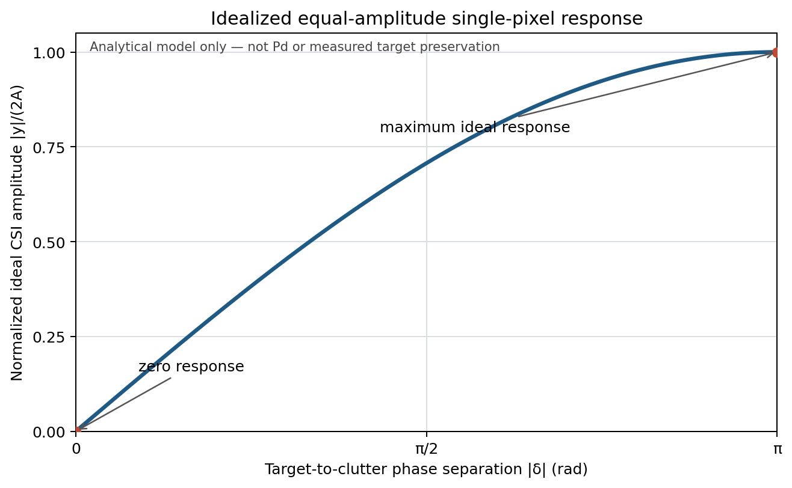

# Phase R2：PGRCC 双通道物理边界与可计算量

审计日期：2026-10-18；源码基线：`1dcea9250c3cbe8655723a210e29638d11d6c095`。本文是基于当前源码、仓库配置与 pilot 场景模板的公式推导，不是新仿真或实测，也不把推导值冒充历史运行观测。正式 pilot 的运行时 XML 未保留在 compact evidence 中；涉及运行时脉冲数的结论因此明确标为配置意图或静态配置对照。

## 结论摘要

1. 四路协议 IQ 先经几何补偿并融合为 F1/F2；生产 CSI 仅以两路复数输入形成一个输出对比量。它没有四路协方差矩阵或四个自适应空间自由度。
2. 在 pilot 模板的 16 GHz、PRF 1300 Hz 下，径向无模糊速度约为 ±6.09 m/s。波束 50 的指令角为 +38°，由 runner 定义的目标速度方向投影后，地速 6.7/12 m/s 的平面参考径向速度约为 6.57/11.76 m/s；不能把地速直接当径向速度。
3. 当前 CSI 的理想目标响应受目标相对杂波参考相位差支配；目标相位越接近被估计的杂波相位，输出越可能被抵消。4 ns 通道时延误差在 50 MHz 带宽下对应约 0.24 个采样间隔及边带 ±0.628 rad 的线性相位偏差，但这是误差模型计算，不是实测退化量。
4. 多普勒混叠、两通道信息上限、有限训练支持、通道失配、目标自消与 CFAR/跟踪损失是不同问题，不能互相代替。当前证据没有给出真实系统误差导致的性能损失—已知误差恢复—盲估计残差闭环，故 R2 不建立 AI 必要性。

## 1. 本次计算采用的输入与范围

| 量 | 采用值 | 依据 / 限定 |
|---|---:|---|
| 载频 `fc` | 16.0 GHz | pilot 场景模板；不是静态 XML 的 16.472113 GHz（模板：`simulator/scenarios/beam50_one_targets_continuous.run.json:6-18`；静态配置：`config/gmti.xml:47-53`） |
| PRF | 1300 Hz | pilot 场景模板 `simulator/scenarios/beam50_one_targets_continuous.run.json:6-18` |
| 采样率 / 带宽 | 60 MHz / 50 MHz | pilot 场景模板 `simulator/scenarios/beam50_one_targets_continuous.run.json:6-18` |
| 接收通道基线 `d` | 0.17 m | pilot 模板 `simulator/scenarios/beam50_one_targets_continuous.run.json:6-18`；静态通道坐标为沿航向 ±0.085 m（`config/gmti.xml:202-214`） |
| 平台速度 / 波束 | 60 m/s；beam 50；角宽 2.28° | 模板 `simulator/scenarios/beam50_one_targets_continuous.run.json:26-47`；beam index 为 1-based |
| 目标速度标量 | 6.7、12 m/s | historical pilot case selection；runner 把该标量映射为固定方向 ENU 分量（`configs/research/production_hierarchical_calibration_delay_pilot.json:186-202`、`scripts/run_track_manager_e2e.py:174-177, 497-501`） |
| 目标延迟误差 | ±4 ns | historical pilot 选定条件，同上；下文只计算该纯延迟模型的理论相位影响 |

模板 `pulse_num=130`，Stage2 配置写入器把 radar 脉冲数写到 `process_pulse_num`（`simulator/stage2_statistical_sim/stage2_config.cpp:610-626`）；当前处理器亦可能按读入的 UTC 脉冲数更新处理长度（`src/processOnePeriod.cpp:2105-2110`）。静态 `config/gmti.xml` 则为 128 脉冲（`config/gmti.xml:181`）。因历史 pilot 的实际 `temp_config_stage2_period_0000.xml` 不在 compact evidence 中，不能断言该次运行最终使用了哪一个 FFT 长度；本报告同时给出两种 bin 间隔。

所有数值是“当前实现 + pilot 场景输入”的可复算估计，不是 2026-09-29 历史 CUDA pilot 的复现。该 pilot manifest 标为 `completed_with_gaps`、`algorithmic_results_claimed=false`，且源码提交为 `6fa1a5f…`，故不把其状态转写成当前源码运行结果（`.scratch/formal_pilot_4ns_seed101_v12/compact_evidence/manifest.json:4-12`）。

## 2. 融合响应与生产自由度

四通道融合对 C3/C4 做几何相位补偿及残余孔径相位补偿，再复数平均：

```text
F1 = (C1 + C3·exp(jφ13)) / 2
F2 = (C2 + C4·exp(jφ24)) / 2
```

这里 `φ13/φ24` 代表代码施加的补偿相位，不是新增观测。GPU 解码核明确输出两路复数均值（`src/gpu/gpu_kernels.cu:1451-1495`）；静态 XML 对应的通道坐标为 C1/C3 沿航向 −0.085 m、C2/C4 +0.085 m，并有垂向配对（`config/gmti.xml:202-214`）。因此四个物理接收输入经融合映射成两个复数数据流，CSI 不能再访问四个独立原始通道。

当前静态模式为 `row_phase_ls_min_magnitude`（`config/gmti.xml:111`）。对 Doppler 行 `r`，代码在距离支持区间估计

```text
αr = Σc F1(r,c)·conj(F2(r,c)) / Σc |F2(r,c)|²
```

将观测写成 `Fi=Ti+Ki+Ni`（通道 `i∈{1,2}`），分别表示目标、杂波和噪声。理想的目标保持分析假设行相位估计主要由目标外、相干杂波支持区决定，即 `arg(αr)≈arg(K1/K2)`；真实估计会受杂波异质性、有限支持和目标污染影响。随后代码只取 `arg(αr)`，将每个像素的两通道幅度都压到 `M=min(|F1|,|F2|)`，再以配置增益 `g` 相减（`src/gpu/gpu_kernels.cu:825-865, 938-985`）。忽略 bypass / coherence gate，令

```text
δ = arg(F1) − arg(F2) − arg(αr)
y = M·exp(j arg(F1)) − g·M·exp(j(arg(F2)+arg(αr)))
|y| = M·sqrt(1 + g² − 2g·cos(δ))
```

若 `g=1`，则 `|y|=2M·|sin(δ/2)|`。这是当前像素相对行相位参考的理想复数响应：`δ=0` 时目标也被消除；`δ=π` 时幅度达到 `2M`。若将 CSI 相位参考视作固定的杂波相位，定义 `δt=arg(T1)−arg(T2)−arg(αr)`，且目标在两路上的独立幅度相等为 `A`，则该式给出孤立目标的条件响应 `2A·|sin(δt/2)|`；但由于生产核先对总信号 `Fi=Ti+Ki+Ni` 做非线性幅度均衡，实际混合目标/杂波输出不能普遍拆成目标项和杂波项的简单线性相加。它不是目标保持率或检测概率的实测估计。幅度取两路较小值意味着强通道的额外幅度不保留；有限距离支持估出的 `αr` 若受目标污染或杂波异质性影响，`δ` 也会相应改变。



图 1：等幅、无噪声、固定杂波相位参考、`g=1` 条件下的解析响应，纵轴为 `|y|/(2A)=|sin(δ/2)|`。CSV 曲线点见 [`idealized_target_response.csv`](figures/idealized_target_response.csv)；用 `python3 scripts/phase_r/plot_idealized_target_response.py` 可复现。该归一化曲线只说明理想单像素的相位响应，不是 Pd、SCNR 改善量或实测目标保真率。

由此得到生产信息边界：四路 IQ → 两路 F1/F2 → 一个 CSI 复数对比输出。当前不是四通道 STAP/JDL，也不是用 2×2/4×4 样本协方差求多个自适应权值的阵列处理器；CSI 最多提供一个跨通道差分对比量。将“增加物理通道数”“增加空间自由度”“改善参数估计”视为同一件事是不成立的。

## 3. 低速、波束投影与 PRF 混叠

### 3.1 指令波束与径向速度

Stage2 按 `θcmd = scan_min + (beam_id−1)·scan_step` 计算角度（`simulator/stage2_statistical_sim/stage2_config.cpp:1258-1268`）。模板给出 `scan_min=−60°`、步进 `2°`，所以 beam 50 为 `+38°`。平台航向由速度方向给出、`squint_side=1` 时，几何函数的波束中心方向在水平 ENU 中为 `u≈(−cosθ,−sinθ)`（`simulator/common/SimulationGeometry.cpp:94-114`）；当前局部轴定义、航向来源和 `squint_side` 配置见 `config/gmti.xml:224-240`。Pilot runner 将目标速度标量 `V` 映射为 `(ve,vn)=(-0.894427191V,-0.447213595V)`（`scripts/run_track_manager_e2e.py:174-177, 497-501`）。故波束中心的平面 LOS 投影为

```text
vr,target ≈ ve·(−cosθ) + vn·(−sinθ)
           = V·(0.894427191 cosθ + 0.447213595 sinθ)
           = 0.980150·V    (θ=38°)
```

仿真真值中的目标径向分量实际按目标速度与 LOS 单位向量点积计算；发射信号总多普勒则用目标相对平台的瞬时径向速度，并受 `motion_doppler_axis_sign` 影响（`simulator/target_injection/lfm_echo_generator.cpp:462-471, 512-523`）。上式是波束中心水平投影，不替代逐脉冲三维真值：平台运动投影、斜距仰角、地球/局部几何、目标运动和波束边缘偏角会改变实际瞬时值。模板 beam width 为 2.28°（`simulator/scenarios/beam50_one_targets_continuous.run.json:26-31`）。

### 3.2 波长、无模糊区与参考 Doppler

采用 `c=299792458 m/s`、`fc=16 GHz`、`PRF=1300 Hz`：

```text
λ = c/fc = 0.0187370 m
中心化无模糊 Doppler 区间 = [−PRF/2, +PRF/2) = [−650, +650) Hz
单基地径向无模糊速度范围 = ±λ·PRF/4 = ±6.0895 m/s
```

本配置 `motion_doppler_axis_sign=−1`（`include/config_structs.hpp:392`、`config/gmti.xml:103-107`；Stage2 写入运行 XML 时传递配置值，`simulator/stage2_statistical_sim/stage2_config.cpp:1188-1190`）。按几何补偿后的目标运动分量 `fd≈−2vr/λ`，并把频率折回中心化 PRF 区间：

| runner 地速标量 | 波束中心平面 `vr` | 未折叠目标运动 Doppler | 中心化折叠值 | 折叠阶数 `q` |
|---:|---:|---:|---:|---:|
| 6.7 m/s | 6.5670 m/s | −700.97 Hz | +599.03 Hz | −1 |
| 12.0 m/s | 11.7618 m/s | −1255.46 Hz | +44.54 Hz | −1 |

折叠定义为 `falias = f − q·PRF`，使 `falias∈[−PRF/2,+PRF/2)`。依该参考几何，地速标量约 `6.0895/0.980150≈6.21 m/s` 就达到无模糊径向边界；因此 6.7 m/s 地速已经略超界，12 m/s 明显超界。此事实说明速度语义和模糊阶数必须保留，不能说明算法失败，也不构成 AI 需求证据。

模板 N=130 时 `Δf=PRF/N=10 Hz`，按 `Δv=λΔf/2` 得约 `0.09369 m/s/bin`；静态 N=128 时分别为 `10.15625 Hz`、`0.09515 m/s/bin`。模糊区间宽度与 bin 分辨率是不同量。历史运行最终 N 未核实，故表中混叠计算依 PRF，不依 FFT 长度。

注意：上表是几何补偿后的目标运动分量，不是原始发射信号包含平台运动后的总 Doppler。Simulator truth 将平台几何项和瞬时双基地 `af_total_truth_hz` 分开记录；在波束边缘，使用指令 look 代替实际 LOS 还会引入偏差（`simulator/target_injection/lfm_echo_generator.cpp:495-525`）。

## 4. 通道基线与时延敏感性

公共发射、双接收模型的等效双程相位中心间距是接收基线 `d/2`，而不是 `d`；代码据此定义等效时间差 `τeq=(d/2)/Vp` 和静止杂波相位斜率（`include/ctdr_phase_model.hpp:100-143`）。取 `d=0.17 m`、`Vp=60 m/s`、PRF=1300 Hz、基线符号 `+1`、通道相位符号 `−1`（Stage2 writer：`simulator/stage2_statistical_sim/stage2_config.cpp:1182-1190`）：

```text
τeq = 1.4167 ms
τeq·PRF = 1.8417 PRT → 整数对齐量 round(τeq·PRF) = 2 PRT
原始相位斜率 = −2π·τeq = −0.008901 rad/Hz
对齐后等效剩余时差 = 2/PRF − τeq = 121.8 μs
相应剩余斜率 = +0.000765 rad/Hz
```

整数 PRT 取整依据及对齐后斜率公式见 `include/ctdr_phase_model.hpp:199-237`。这是代码理论对齐模型的计算值；不能用静态 `d` 或某一地速数值替代实际运行时姿态/基线。旋转基线有横向分量时，源代码明确说明一个标量 PRT 位移不能对齐完整接收路径，须由几何相位模型处理（`src/processOnePeriod.cpp:420-435`）。

纯时间延迟 `τerr` 的频域相位是 `Δφ(f)=2πfτerr`。历史 ±4 ns pilot 条件在 `fs=60 MHz` 下为 `0.24` 个采样间隔；在带宽 ±25 MHz 两端，相对带中心相位约 `±0.628 rad`（36°），两端相差约 `1.257 rad`（72°）。这是理想纯延迟模型下的确定性频率斜率，不包含脉压窗、通道滤波、几何补偿、噪声或估计器效果，也不是历史 pilot 观测到的残余相位。

## 5. 五类影响必须分开判读

| 类别 | 在 PGRCC 中的作用 | 目前可得结论与限制 |
|---|---|---|
| 物理空间/时间响应 | 两路相位中心、目标/杂波方向、平台速度与多普勒决定跨通道相位；CSI 只能保留相对行参考有差异的分量。 | 由上述双通道响应模型可推导。低速目标可能因相位接近杂波参考而被抑制；要量化须使用真值几何与匹配输入，不能由速度标量直接推检测损失。 |
| 通道系统失配 | 时延、幅度/相位、时钟、姿态/波束和基线误差会改变 `F1/F2` 的幅相关系。 | 4 ns 只给出量级示例。需区分真实误差、估计残差和物理模型偏差；本计算没有观测到系统中确实存在该误差。 |
| 有限样本 / 杂波异质性 | 当前每个 Doppler 行的 `αr` 由指定距离支持区间的互相关与能量比估计，并非四通道样本协方差求逆（`src/gpu/gpu_kernels.cu:825-865`）。 | 有效独立距离样本数、相关长度、杂波非平稳性及训练区目标污染尚未从实际输入核实。不能套用未知样本数的 STAP 协方差误差或 RMB 样本门槛。 |
| 目标自消 / 目标保持 | 同一个行相位参考会作用于目标像素；若目标与参考相位相近，公式直接给出低输出。 | 这是 CSI 的结构性 trade-off，不是估计器一定有 bug。需由 `TO`、`ON−OFF` 和下游检测/航迹证据区分目标被 CSI 抑制与目标本来低信噪比。 |
| CFAR / 聚类 / 关联 | CSI 输出之后还有阈值、CUT 选择、连通/小簇过滤、定位速度与 TrackManager。 | 通过某个相位残差或 CSI 输出不等于检测/航迹成功；配置 Pfa 不等于实测 Pfa，必须有正的有效 CUT 分母并追踪每一层（参见 R0）。 |

## 6. CRLB / FIM 的适用边界

当前不报告 CRLB、FIM 或“理论最优误差下限”。要形成可审查的界，至少要先冻结观测方程和条件变量，并给定目标幅相、杂波协方差/异质性、噪声、通道误差与姿态误差的联合统计模型，说明哪些 nuisance 参数未知、哪些参数可辨识、观测样本独立性及估计器偏差。当前真实系统未知误差分布、有效独立样本数和干扰协方差没有证据化；把任意独立高斯噪声或均匀杂波假设塞入公式只会得到与真实任务无关的界。可在 R3/R4 明确实验条件后，对那个受限的仿真模型另行推导，不能泛化成真实 airborne GMTI 界。

## 7. R2 判读与后续门槛

R2 建立了 PGRCC 当前的信息边界、几何投影、多普勒模糊和 CSI 目标响应的可计算基线；它没有证明历史 pilot 的误差已导致损失，也没有证明确定性估计器无法恢复该损失。低速混叠和双通道目标抵消都具有明确的物理/算法结构，优先需要正确速度语义、通道几何校准、误差真值与端到端因果指标，而不是自动引入 AI。

继续评估 AI 的必要条件仍是：当前真实或有代表性的误差先造成可重复的性能退化；Known-error correction upper bound 显示存在可恢复空间；再由盲的确定性物理估计报告误差、残差和置信度，并验证残差会传播到检测/航迹；只有确定性方法留下可归因且无法解析建模的剩余误差，才进入 AI 候选。历史 pilot 当前仍是 `NOT_EVALUABLE` / `completed_with_gaps`，不能替代这些门槛（`.scratch/formal_pilot_4ns_seed101_v12/compact_evidence/report.md`、对应 manifest）。

四条件 raw-IQ pilot 的相位残差指标为 lower-is-better。按原任务的方向定义，原始差值 `Known−Current = −0.2004197161 rad`、`Estimated−Current = −0.2004197159 rad`；等价的正向改善量为 `Current−Known = 0.2004197161 rad`、`Current−Estimated = 0.2004197159 rad`，故方向归一化恢复率 `(Current−Estimated)/(Current−Known) = 0.9999999991`。该比例只表示这个无面积杂波、配对参考相位残差条件下，Estimated 与 Known-error correction upper bound 的差距很小；不能解读为杂波抑制率、Pd 增益或 Physics-AI 收益。详细输入与计算量见 [`phase_ii_raw_iq_pilot_summary.json`](phase_ii_raw_iq_pilot_summary.json)。

## 2026-10-21 补充：R3 的单一时延因果证据

本节更新上述 R2 时点的“未知误差是否已导致任务性能退化”判断；原段落对 2026-10-18 以前历史 pilot 的限制仍然成立。R3 在有效连续面积杂波的 CUDA Production 链路中，对 seed 101/202/303 注入单一 `+4 ns` 通道时延误差。三 seed 的角度、跟踪地速和位置 RMSE 均呈 `B(Current + unknown error) > A(0 ns)` 且 `C(Known physical correction) < B` 的同向关系；以下是跨 seed 描述性中位数：

| 指标（越低越好） | A：0 ns | B：+4 ns Current | C：Known correction |
|---|---:|---:|---:|
| Angle RMSE (deg) | 0.044153 | 0.125759 | 0.013185 |
| Track ground-speed RMSE (m/s) | 5.1659 | 9.1097 | 1.2792 |
| Position RMSE (m) | 82.524 | 197.823 | 20.566 |

R3 的 A↔C F1/F2 复数输入闭合在 ON/OFF/TO 三种配对角色均通过预设相对 RMS `1e-3`；这是该仿真干预的物理校正闭合，不是实机校准精度。方向在 3 个 seed 上重复，但单一仿真场景不等于真实系统误差分布，也不构成显著性检验或普适 Pd/Pfa 结论。R3 的 D 条件、目标/杂波指标和失败项见 [`06_minimal_cuda_causal_pilot.md`](06_minimal_cuda_causal_pilot.md) 与 [`06_bottleneck_experiment_results.md`](06_bottleneck_experiment_results.md)。

R2 阶段记录时未运行新实验、未改变运行代码，也未改动或删除任何历史 scratch/output/package。当时计划先完成 R3 评价链审计，再冻结 R4 最小实验设计；后续实际执行状态见下方 R3 补充、[04 评价审计](04_evaluation_pipeline_audit.md)和[06 结果合并](06_bottleneck_experiment_results.md)。

## 2026-10-21 补充：Phase-I 敏感度证据修正

对历史 54 组已保存观测的[离线复核](phase_i_observability_reanalysis.md)确认了圆周相位中心差分错误。汇总条件数从 37.32835 改为 3.99259，delay–servo 列余弦从 −0.91995 改为 −0.06815；逐 seed 条件数差异、FFT argmax 跳变、参数尺度和派生重复特征仍影响判读。这些数值是代理观测域的有限差分诊断，没有观测噪声模型，不能作为 FIM/CRLB、稳定物理辨识或 AI 入口证据。原历史报告和矩阵未回写；后续引用以补充复核的适用范围为准。
