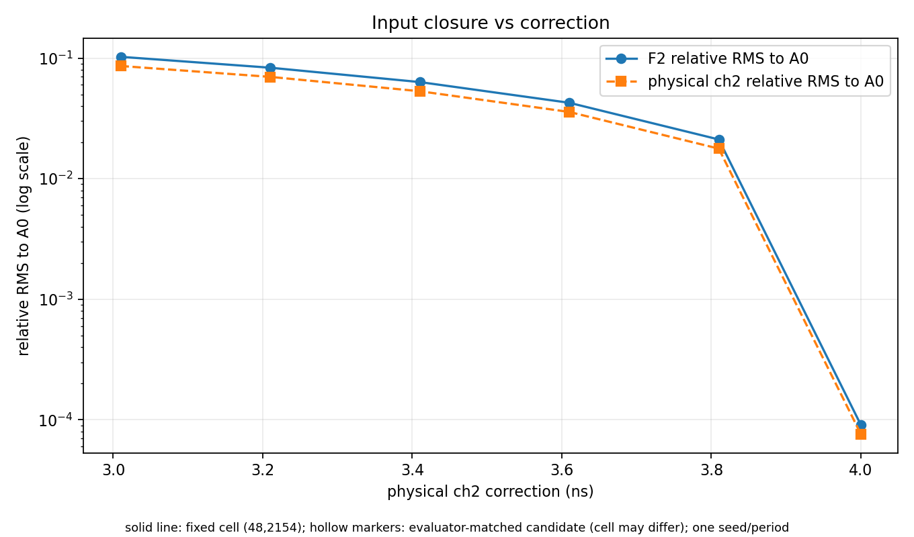
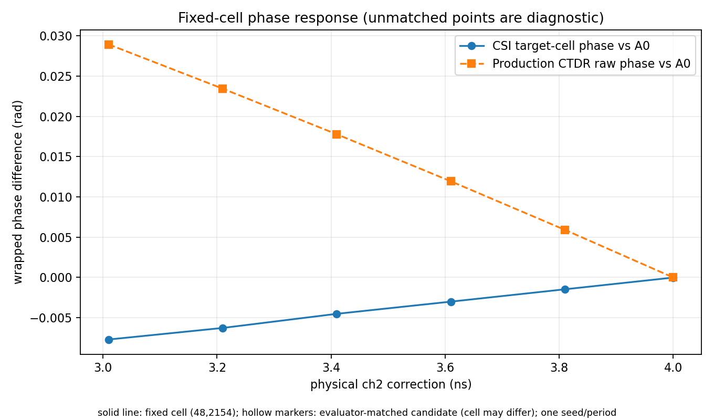

# R11：通道时延校正量到 CTDR 相位的敏感度

## 结论范围

本报告使用 seed303、period 1、beam 50 的 A1/ON 连续面积地杂波协议 IQ，在六个预注册通道 2 校正量上运行 R7 Native CUDA Production。输入、构建、处理链身份和停止条件见[冻结设计](R11_experiment_design.md)及[紧凑证据包](evidence/r11_local_delay_scan_20261024/README.md)。这是一组单 seed、单 period 的受控敏感度扫描。

状态：`IMPLEMENTED`（runner 与设计已存在）；`EXECUTED`（六个正式 CUDA 分支完成）；`EVALUABLE`（输入、CSI、CTDR raw/corrected phase 和固定 cell 几何输出可评估）；任务级跨场景 `PERFORMANCE_VERIFIED`：否。

## 处理链与门控

- Native binary：`build_r7/GMTI_pipe_core`，SHA-256 `de3026ed4f1263be4143dcbcd10ccbb5e53b4be357e21906e1bf19ea0ec29d00`；`USE_COREX=OFF`。GPU：NVIDIA GeForce RTX 3050 Laptop GPU，driver 580.178.04。设备状态和六个分支的实际配置、日志、CFAR、CSI summary、候选及 lineage 在证据包内。
- 输入是既有 Stage2 A1/ON period 1 原始数据；本实验没有重跑 Stage2。原始输入 49,204,480 bytes，SHA-256 `f7506d535f54e77da8f74843b7cf2e7506e656f45d2430ab81ee6bfb6c236a0f`。A0/ON 对照同大小，SHA-256 `8f2e089f89ad29080146837cd93d964e29ed1daf6e39b17a2e472a2f42905b81`。
- 每个校正输入都保留 130 个 packet；header 及物理通道 1/3/4 逐字节不变，只有通道 2 改写。4.000000 ns 输出与 R8 Known Correction 输入 SHA 完全一致。F1 相对 A0 RMS 为 0；F2 Known 门槛为 `1e-3`，实际 `9.0822e-5`。输入门通过。
- 六个分支退出码均为 0，Runtime XML 与有效配置快照、CUDA new-protocol preprocessing、CSI cancellation、CFAR、timing、CSI tap、geometry 和 detection lineage 齐全。每个 period 的 `union_dynamic_in_band` 与 `union_full_band` 均报告 527,280 valid CUT。生产质量门未调整。

## 校正输入与 CSI 响应

| ch2 校正 (ns) | 剩余时延 (ns) | ch2 相对 RMS | F2 相对 RMS | CSI 幅度比 A0 | CSI 相位差 A0 (rad) |
|---:|---:|---:|---:|---:|---:|
| 3.009965 | 0.990035 | 0.08600245 | 0.10245167 | 1.07657975 | -0.0077001205 |
| 3.209965 | 0.790035 | 0.06985247 | 0.08321276 | 1.06486630 | -0.0062657334 |
| 3.409965 | 0.590035 | 0.05311419 | 0.06327304 | 1.04882354 | -0.0045137131 |
| 3.609965 | 0.390035 | 0.03575665 | 0.04259563 | 1.03566188 | -0.0030026706 |
| 3.809965 | 0.190035 | 0.01774732 | 0.02114175 | 1.01914282 | -0.0014706355 |
| 4.000000 | 0 | 0.00007624 | 0.00009082 | 1.00019684 | -0.0000158391 |

校正量靠近 4 ns 时，通道 2、F2 和 CSI 复响应逐级闭合到 A0；F1 保持严格不变。4 ns CSI 复响应为 `(2412.93359375 + 5533.4091796875j)`，A0 为 `(2412.37109375 + 5532.3583984375j)`，幅度比偏离 1 约 `1.97e-4`。逐点、逐 tap 的实虚数与源 map SHA 见 `target_cell_csi_responses.csv` 和 `csi_map_cleanup_ledger.csv`。

## CSI 到 CTDR 相位

注册 cell 为 `(row=48, col=2154)`。以下相位差均相对 R8 A0/ON Production 同 period、同 cell；raw phase 使用包裹差。Production 对该 cell 的 raw phase 在六个校正量下均有实际检测，cluster lineage 均标为 selected。

| ch2 校正 (ns) | CSI 相位差 (rad) | CTDR raw phase 差 (rad) | Production corrected phase `phase_rad` (rad) |
|---:|---:|---:|---:|
| 3.009965 | -0.0077001205 | 0.0289193364 | 0.0351624675 |
| 3.209965 | -0.0062657334 | 0.0234287949 | 0.0313961692 |
| 3.409965 | -0.0045137131 | 0.0177708613 | 0.0267298184 |
| 3.609965 | -0.0030026706 | 0.0119349463 | 0.0213697869 |
| 3.809965 | -0.0014706355 | 0.0059102243 | 0.0162648838 |
| 4.000000 | -0.0000158391 | -0.0000000447 | 0.0115839010 |

raw phase 差由 `+0.0289193 rad` 单调收敛至近机器精度；Production corrected phase 也向 A0 收敛。Known 4 ns raw phase closure 的预注册门槛为 `0.001 rad`，实际绝对差 `4.47e-8 rad`，通过。CSI 与 CTDR phase 是连续处理链的相邻观测，二者不作为互相独立的重复验证。

## 失败尝试和证据边界

首次 CUDA 启动因 local-test selector `2@1=<file>` 将单文件读取 offset 设为 1，reader 请求 260 PRT 而文件只有 130，尚未进入正式处理 stage 即失败。该失败没有用于算法比较，配置、日志和错误现场保留在证据包 `failure_attempt_01/`。只把 selector 修正为 `2=<file>` 后重跑六个分支；处理条件、阈值和物理参数不变。

本扫描说明受控改变 ch2 逆校正量会改变融合 F2、CSI 与生产 CTDR 相位，且已知 4 ns 输入能闭合到 A0。它不证明统计显著性、跨 seed 泛化、Pd/Pfa 改善或独立盲估计器的性能。
