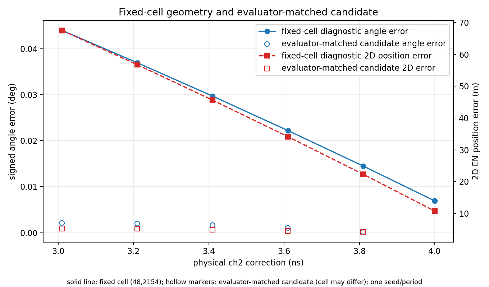
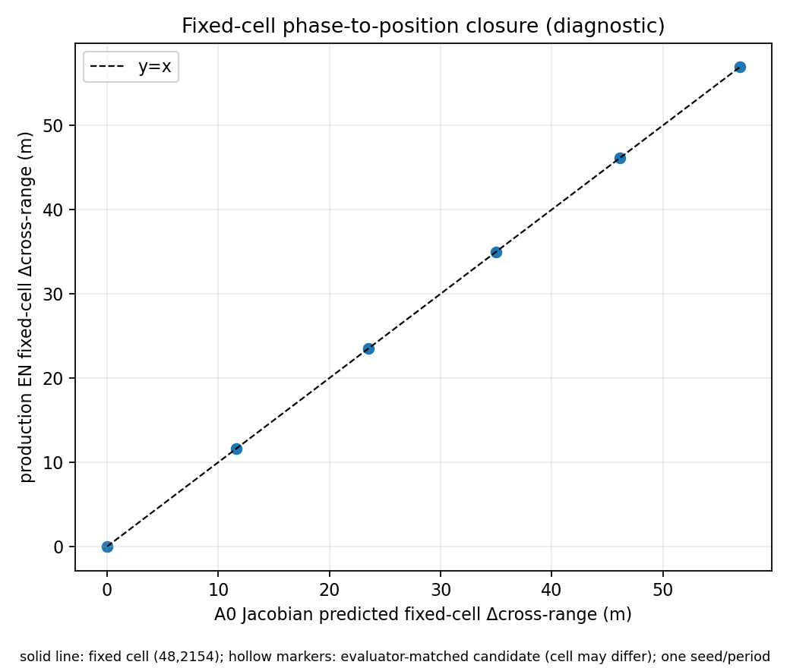

# R11：固定 cell 几何误差与目标候选匹配分析

## 结论范围

本报告按冻结评价器分别呈现注册 cell `(48,2154)` 的 Production 几何诊断和真实 one-to-one 评价器匹配到的 detection。两者不能互相替代。固定 cell 在六个条件下都被 Production 检出且 cluster selected，但前五个条件的冻结评价器把 truth 配给 `(129,2155)`；只有 4 ns 配回 `(48,2154)`。没有强制匹配或按结果改动门限。

## 固定 cell 的相位到几何响应

A0 fixed-cell cross-range Jacobian 为 `1968.12214084135 m/rad`。预注册预测为 `J_A0 × wrap(phase_i − phase_A0)`，并与同一固定 cell 的实际 EN 位置投影比较。下表的角度、横向/距离/二维误差是该 cell 相对 truth 的诊断量；在前五点它们不是评价器认定的目标 detection 性能。

| 校正 (ns) | 相位差 A0 (rad) | 预测 Δcross-range (m) | 实测 Δcross-range (m) | Jacobian 闭合残差 (m) | 固定 cell 角度误差 (deg) | 固定 cell 二维位置误差 (m) |
|---:|---:|---:|---:|---:|---:|---:|
| 3.009965 | 0.0289193364 | 56.916786 | 56.931272 | 0.0144861 | 0.04399793 | 67.580839 |
| 3.209965 | 0.0234287949 | 46.110730 | 46.120237 | 0.0095066 | 0.03695747 | 56.773732 |
| 3.409965 | 0.0177708613 | 34.975226 | 34.980694 | 0.0054688 | 0.02970307 | 45.640135 |
| 3.609965 | 0.0119349463 | 23.489432 | 23.491898 | 0.0024663 | 0.02222123 | 34.161463 |
| 3.809965 | 0.0059102243 | 11.632043 | 11.632648 | 0.0006047 | 0.01449814 | 22.323475 |
| 4.000000 | -0.0000000447 | -0.000088 | -0.000088 | 0.0000000010 | 0.00692256 | 10.756963 |

六个闭合残差最大 `0.01449 m`，低于设计冻结的 `1.0 m` 门槛。3.409965 ns（R10 固定 D3 值）到 4 ns，fixed-cell 二维误差从 `45.6401 m` 降到 `10.7570 m`，角度误差从 `0.0297031°` 降到 `0.00692256°`。4 ns 的角度和位置误差分别与 A0 相差 `5.73e-8°`、`8.69e-5 m`，Known-to-A0 门均通过。A0 本身仍有约 10.76 m 的绝对定位误差，因此 Known Correction 是恢复到 A0，不是恢复到零误差。

## 评价器实际匹配的 detection

| 校正 (ns) | 评价器匹配 cell | matched 角度误差 (deg) | matched cross-range 误差 (m) | matched range 误差 (m) | matched 2D 误差 (m) | CFAR margin (dB) |
|---:|:---:|---:|---:|---:|---:|---:|
| 3.009965 | (129,2155) | 0.00210783 | 3.236792 | 4.152461 | 5.264955 | 1.442610 |
| 3.209965 | (129,2155) | 0.00199165 | 3.058384 | 4.152468 | 5.157199 | 1.440659 |
| 3.409965 | (129,2155) | 0.00164559 | 2.526970 | 4.152484 | 4.860937 | 1.436695 |
| 3.609965 | (129,2155) | 0.00104057 | 1.597896 | 4.152506 | 4.449335 | 1.430421 |
| 3.809965 | (129,2155) | 0.00015542 | 0.238665 | 4.152520 | 4.159373 | 1.421511 |
| 4.000000 | (48,2154) | 0.00692256 | 10.629998 | 1.647844 | 10.756963 | 13.327383 |

该序列不是同一个 cell 的性能曲线：前五点和 4 ns 的候选不同。冻结 one-to-one matcher 的 cost 同时归一化 EN 位置误差与距离误差（配置最大值分别为 1000 m 和 100 m，关闭速度门）。D3 的 `(129,2155)` cost 为 `0.0260465`，小于 `(48,2154)` 的 `0.0494373`；4 ns 时 `(48,2154)` cost 为 `0.0145541`，低于仍存在的 `(129,2155)` 的 `0.0255960`。因此最后一个点换候选由冻结 cost 的复合距离/位置项决定，不应改 matcher 来维持候选。

4 ns 的 `(129,2155)` detection 仍在 Production 输出中，且其单独 EN 误差约 `4.41 m`；但冻结评价器没有将 truth 配给它，所以此值只能作为 alternate-candidate 诊断，不能用来覆盖冻结的正式匹配记录。完整候选、CFAR、detection 和 cluster lineage 均在证据包中。

## 因果解读与限制

1. ch2 逆校正量改变后，F2 输入、CSI、固定 cell raw phase 和固定 cell 几何误差按预期连续收敛；同 seed/period 的操纵输入及 A0 对照支持该场景内的因果解释。
2. Jacobian 闭合检验的是生产局部相位—几何映射是否与该生产输出自洽。它不独立证明真实平台只有通道时延一种误差，也不分离分数延迟插值、四通道融合及 CTDR 解算各自的误差份额。
3. 评价器匹配候选在 4 ns 切换，导致匹配目标的二维误差从前一点 `4.159 m` 变为 `10.757 m`。这不是单调的端到端任务改善证据。它与 fixed-cell 几何响应是不同的结果，应在下一步核查定位 cost 对 target candidate 的敏感度，但本阶段不改变评价器。
4. 单 seed、单目标、单 period 不支持统计显著性、普遍 Pd/Pfa 或跨场景结论。CFAR margin 是具体 detection 的输出记录，不是虚警率估计。
