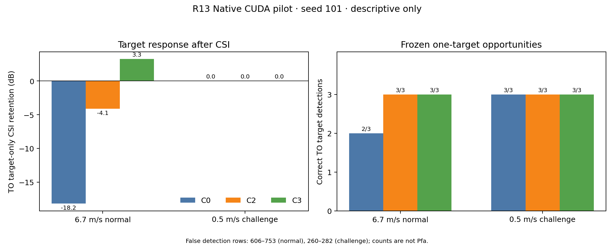

# R13 最小传统 Baseline 比较结果

日期：2026-10-25。结果只覆盖 seed101、两场景、每场景三个 period。完整 manifest、逐 branch runtime/config/log、机器 CSV 和清理记录见 [R13 CUDA 证据包](evidence/r13_baseline_cuda_20261024/README.md)。

## 运行身份与状态

- 执行：本机 Native CUDA，`USE_COREX=OFF`；NVIDIA GeForce RTX 3050 Laptop GPU、driver 580.178.04、CUDA 13.0。记录时 P5、48°C、7 W/40 W、1027/4096 MiB；运行前 GPU utilization 分别 41% 与 29%。这些是环境快照，不是性能基准。
- Source commit at execution：`3289c13bab6457bd1b190e393ddb01d51e9448e5`，tracked dirty=false。
- Stage2 binary SHA-256：`5dd0ac4e2536b8bcf2508cc53db8a30780eba75f40c025e13ffaa930f8ba7b9b`。
- Production binary SHA-256：`f65a8aa446754cc79b6417f9275b3a01e73eb85098c6a4f9eaea0cb999c38962`。
- Config SHA-256：`6c38544849d842ff79903f7489b2907fb7bce615b36413cf9a8e5e89645b71e8`；runner SHA：`0429528d22164f5a1a4a1c0a29b60f4b5c374aea2efabaaf6f52499ed995e2d9`；R13 evaluator SHA 存于 analysis manifest。
- 24/24 Production branches 返回 0 且 Production gate 通过；36 C2/C3 adapter rows 均 OK、truth-used=false、无 Current fallback；72/72 CFAR union map audit 通过；18/18 F1/F2 输入组跨 A0/C0/C2/C3 完全一致。
- legacy runner 汇总状态仍为 `completed_with_gaps`，因为其 delay-residual closure 要求 A0/PK/PKR，而 R13 冻结子集没有 PK/PKR。这个遗留问题不表示 24 个 R13-selected branches 失败；R13 的任务 evaluator manifest 状态为 `evaluated`，只用于本报告列出的任务指标。
- `IMPLEMENTED`、`EXECUTED`、具体指标 `EVALUABLE` 如契约所列；`PERFORMANCE_VERIFIED=false`。本轮没有统计性 Pd/Pfa。

## 杂波与处理输入

Area clutter 几何可达，Stage2 writer 实际生成 390 continuous-area packets 和 1,952,655 samples，mean power 0.0223353、lag-1 rho 0.980007。OFF 三期输入与 writer 的 C+N background SHA 逐期相同。每 period 的 F1/F2 生产 active support 为 39×4095=159,705 cells；F1/F2 input power map SHA 在所有方法间逐期相同。GO-CFAR 每图 527,280 valid CUT，三期累计 1,581,840。

## OFF/H0 描述输出

| 方法 | unique union hits | observed fraction（不是 Pfa） | OFF detections | Confirmed + current matched track-period associations | H0 active-support CSI power change |
|---|---:|---:|---:|---:|---:|
| C0 Current | 83,985 | 5.3093% | 406 | 171 | +5.642 dB |
| C2 SCC | 76,033 | 4.8066% | 393 | 163 | −0.858 dB |
| C3 Robust DDC | 64,365 | 4.0690% | 405 | 169 | +2.175 dB |

功率变化定义为 `10log10(before/after)`，包含 C+N；C2 在该 active support 上输出均功率反而升高。CFAR hit fraction 和 detection/track 计数均为场景描述，不换算成 Pfa。

## 目标任务与参数

| 场景/方法 | ON correct detections | ON false detection rows | TO correct detections | TO false detection rows | TO target CSI retention | Output SCNR proxy | ON position RMSE | ON angle RMSE | ON folded Doppler RMSE | ON ground-speed RMSE (n) |
|---|---:|---:|---:|---:|---:|---:|---:|---:|---:|---:|
| 6.7 m/s C0 | 3/3 | 555 | 2/3 | 707 | −18.178 dB | 67.218 dB | 40.37 m | 0.02634° | 14.596 Hz | 0.368 m/s (2) |
| 6.7 m/s C2 | 3/3 | 1,000 | 3/3 | 753 | −4.106 dB | 80.661 dB | 27.91 m | 0.01809° | 3.967 Hz | 0.360 m/s (2) |
| 6.7 m/s C3 | 3/3 | 693 | 3/3 | 606 | +3.252 dB | 86.245 dB | 27.91 m | 0.01809° | 3.967 Hz | 0.360 m/s (2) |
| 0.5 m/s C0 | 3/3 | 305 | 3/3 | 277 | +0.019 dB | 66.025 dB | 22.76 m | 0.01481° | 2.659 Hz | 0.097 m/s (2) |
| 0.5 m/s C2 | 3/3 | 313 | 3/3 | 282 | +0.019 dB | 66.025 dB | 22.76 m | 0.01481° | 2.659 Hz | 0.389 m/s (2) |
| 0.5 m/s C3 | 3/3 | 325 | 3/3 | 260 | +0.019 dB | 66.025 dB | 22.76 m | 0.01481° | 2.659 Hz | 5.148 m/s (2) |

False detection rows are the final detection rows not matched to the single target under the frozen one-to-one R7 evaluator gate; they are counts, not probabilities. Ground speed has only two strict confirmed target track-period associations per method. Radial velocity remains unresolved and is not reported as an RMSE.

For normal speed, the paired complex CSI transfer (TO → ON−OFF) amplitude/phase was C0 `+2.120 dB / −0.0775 rad`, C2 `−0.024 dB / −0.0389 rad`, C3 `−0.057 dB / −0.0495 rad`. It is an adaptive paired-response diagnostic, not a fixed gain. C2/C3 produce a candidate target-preservation difference on normal-speed TO; all methods still detect 3/3 in ON, and false output counts are high. At 0.5 m/s the CSI transfer/retention and position/angle/folded-Doppler rows are identical across methods in this single seed; C3 ground-speed error is conspicuously larger.

## 共同成功机会上的参数比较

下表来自 `analysis/pairwise_common_opportunities.csv`。每一对方法只在双方都正确关联到同一真值 period 的交集上重算 RMSE；它与上面的各方法全体成功样本 RMSE 不同。共有机会很少，仍只是 seed101 的描述性结果。

### 正常速度 TO

| 方法对 | 参数 | 共同机会数 | 左侧 RMSE | 右侧 RMSE |
|---|---|---:|---:|---:|
| C0 → C2 | 位置 | 2 | 8.613 m | 28.523 m |
| C0 → C2 | 方位 | 2 | 0.00555° | 0.01846° |
| C0 → C2 | 折叠 Doppler | 2 | 17.413 Hz | 3.801 Hz |
| C0 → C2 | TrackManager 地速 | 2 | 0.339 m/s | 3.934 m/s |
| C0 → C3 | 位置 | 2 | 8.613 m | 28.523 m |
| C0 → C3 | 方位 | 2 | 0.00555° | 0.01846° |
| C0 → C3 | 折叠 Doppler | 2 | 17.413 Hz | 3.801 Hz |
| C0 → C3 | TrackManager 地速 | 2 | 0.339 m/s | 0.413 m/s |
| C2 → C3 | 位置 | 3 | 27.913 m | 27.913 m |
| C2 → C3 | 方位 | 3 | 0.01810° | 0.01810° |
| C2 → C3 | 折叠 Doppler | 3 | 3.967 Hz | 3.967 Hz |
| C2 → C3 | TrackManager 地速 | 2 | 3.934 m/s | 0.413 m/s |

因此 C2/C3 相对 C0 的正常速度 TO 检出与 CSI 目标保持候选伴随定位、方位和地速误差代价；折叠 Doppler 误差较小。C2/C3 在位置、方位和折叠 Doppler 的共同机会值相同，地速则 C3 较小。不能把其中任一指标单独解释成整体任务收益。

### ON 与低速挑战

- 正常速度 ON：C0 对 C2/C3 的共同样本为位置/方位/折叠 Doppler 各 3 次、地速 2 次。RMSE 从 C0 的 `40.365 m / 0.02634° / 14.596 Hz / 0.368 m/s` 到 C2/C3 的 `27.909 m / 0.01809° / 3.967 Hz / 0.360 m/s`；C2 与 C3 在这些共同机会完全相同。
- 0.5 m/s ON：三方法的位置、方位、折叠 Doppler RMSE 完全相同（`22.763 m / 0.01481° / 2.659 Hz`，各 n=3）。地速 n=2，C0/C2/C3 分别为 `0.097 / 0.389 / 5.148 m/s`。
- 0.5 m/s TO：位置、方位、折叠 Doppler 也相同（`22.875 m / 0.01488° / 2.659 Hz`，各 n=3）。地速 n=2，C0/C2/C3 分别为 `17.990 / 0.255 / 0.584 m/s`。这些数值没有形成可重复或统计结论。

## Production 单次运行耗时

`analysis/branch_inventory.csv` 的 `production_elapsed_sec_single_run` 按方法和同场景 OFF/ON/TO 三次取均值及范围：

| 场景 | 方法 | 三次均值 | 最小–最大 |
|---|---|---:|---:|
| 6.7 m/s | C0 | 4.490 s | 3.722–5.225 s |
| 6.7 m/s | C2 | 5.341 s | 3.671–6.878 s |
| 6.7 m/s | C3 | 4.607 s | 3.721–5.224 s |
| 0.5 m/s | C0 | 4.707 s | 4.373–5.024 s |
| 0.5 m/s | C2 | 6.711 s | 4.723–8.230 s |
| 0.5 m/s | C3 | 3.404 s | 3.120–3.722 s |

每格只有 OFF/ON/TO 各一次 branch 记录；这些耗时用于报告本次执行开销，不是 warm-up 后的重复性能基准，也不能据此断言 C2/C3 的稳定速度排序。

## 解释边界

1. **多指标权衡而非已验证的净胜：** 正常速度 TO 的 CSI retention 与正确检测计数提示 C2/C3 值得有限复核；共同成功机会比较同时显示位置、方位和地速代价。C2/C3 使用 paired OFF 标定，C0 不用；这是不同信息条件的操作能力对比。C2 与 C3 之间的信息条件相同。
2. **低速未被确认为瓶颈：** 一个 0.5 m/s seed 中，检测均 3/3、CSI target response 相同；这既不证明低速不重要，也不支持将其升级为主线。
3. **虚警不可作统计结论：** OFF hits、detection 和 track 计数均是描述性；经验 Pfa 不可评估。
4. **无未知误差因果结论：** 本次注入 delay=0 ns；不能用本实验回答未知误差是否普遍降低任务性能、Known correction 可恢复多少或 blind estimation 距离 Known 多远。Mode-A 使用配对 OFF 数据，不是 blind estimator。
5. **单 seed 限制：** 三个 period 不是独立 seed；无统计显著性、无 benchmark 性能主张。
