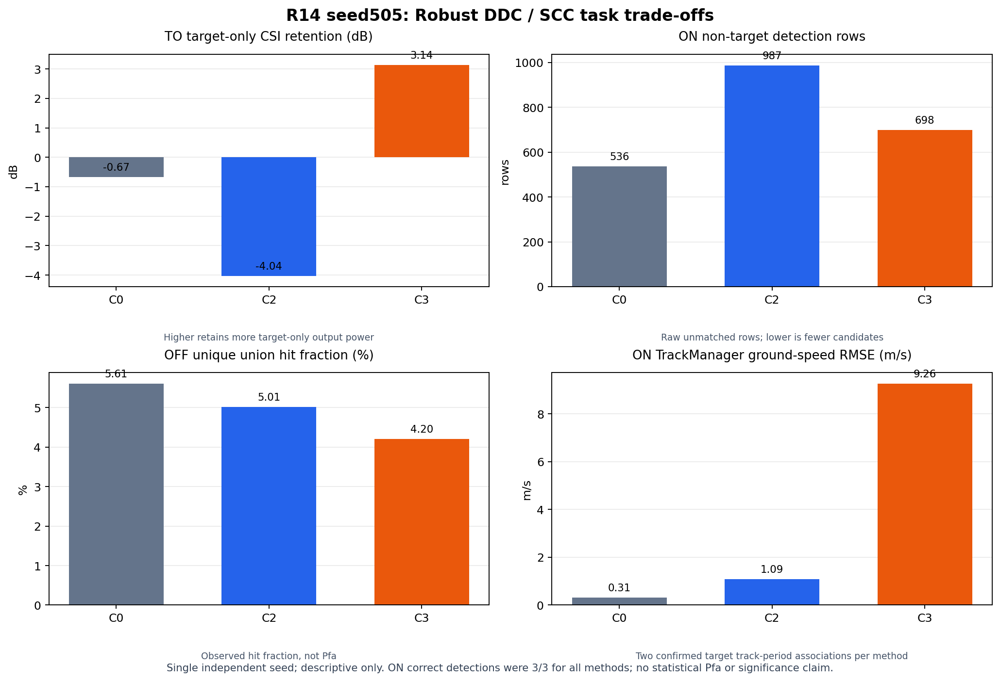

# R14 SCC 与 Robust DDC 独立 seed 任务比较结果

日期：2026-10-25。范围：seed505、正常速度 6.7 m/s、SNR 30 dB、通道时延 0 ns、beam 50、3 periods。R14 只复核 R13 的 SCC（C2）与 Robust DDC（C3）差异；C0 是 Production Current 锚点，A0 是 runner/evaluator 要求的闭合控制。

## 状态与结论边界

- `IMPLEMENTED`：R13 evaluator 增加单场景入口；R14 使用冻结配置和现有 Production runner、R7 matcher、CFAR evaluator。
- `EXECUTED`：本机 RTX 3050 Laptop GPU、`USE_COREX=OFF`、`skip_cuda=false`；A0/C0/C2/C3 × OFF/ON/TO 共 12 个 Production branches 均返回 0 并通过 branch gate。
- `EVALUABLE`：本 seed 的配对输入、面积杂波、F1/F2、CSI ROI、final-union CFAR map、检测和 TrackManager 记录闭合；R14 evaluator 12 branches 状态为 `evaluated`。
- `PERFORMANCE_VERIFIED`：**否**。这是一枚独立 seed 的描述性复核，不是统计性 Pd/Pfa 或显著性证明。

runner 与 case manifest 的总状态仍为 `completed_with_gaps`，原因是通用旧 runner 的 residual-closure gate 要求 PK/PKR 分支，本次冻结 R14 子集没有运行 PK。R14 所需的 12 branches 和本报告所列 evaluator 指标均通过；此处不将通用残差闭合写成 R14 生产失败，也不隐去该 gap。

## 生产路径与配对输入门

| 门 | 本轮证据 | 状态 |
|---|---|---|
| CUDA | RTX 3050、driver 580.178.04、CUDA 13.0；runner 记录 GPU 可见、`skip_cuda=false`；Production log 记录 device LUT 上传、`new_protocol_gpu_preprocess: enabled` 和 CUDA free memory | 通过 |
| `useGpu=0` 日志项 | runtime XML 中 `dbs_mosaic_use_gpu=false`；源码注释说明它只控制最终展示拼图，不关闭信号处理 CUDA 路径。该标志不能单独解释为 Production CSI/CFAR 在 CPU 上运行 | 已核实 |
| 生产 branches | 12/12 `status=passed`、`production_status=passed`、return code 0；12/12 TrackManager 审计 violation 为 0 | 通过 |
| 面积地杂波 | `continuous_texture`；平台高度 6000 m；斜距窗 84.5–85.5 km；地距约 84.287–85.289 km；390 packets、1,952,655 samples、实测平均功率 0.0234967 | 通过 |
| 配对 OFF/ON | 三期 OFF=C+N 与背景 writer 文件 SHA 一致；三期 ON=S+C+N 与 Stage2 writer 一致 | 通过 |
| C2/C3 输入可比性 | 9 个 role×period F1/F2 审计组均 verified；每组 F1、F2 各只有一个输入 SHA；C2/C3 Mode-A 都从相同 OFF reference 信息类别拟合，truth-used=false，无 Current fallback | 通过 |
| CFAR | 36/36 period-branch final-union map 与 geometry/log 审计通过；每张图 527,280 valid CUT，每 branch 三期合计 1,581,840 | 通过 |

`dbs_mosaic_use_gpu=false` 对应 `include/config_structs.hpp` 中“仅控制最终展示拼图”的注释。生产日志同时记录 CUDA 设备 LUT 上传、GPU preprocessing 和设备可用内存；该显示选项不等于停用生产信号处理 CUDA 路径。运行时 XML、branch logs 与源码身份保存在证据包。

## CSI 处理差异与目标响应

C2 使用每期一个全局复数 SCC 系数，覆盖 159,705 个 active-support cells；C3 对每个 Doppler row 单独拟合 Robust DDC。C3 的 OFF 拟合共 117/117 groups 有效，固定 0.35 rad 相位门保留 93,826 / 479,115 = 19.583% 的支持样本；逐组保留数 min/median/mean/max 为 658/807/801.9/943。约 80.4% 支持样本未参与拟合；本轮未调阈值。Mode-A 的参考只从 target-free OFF 拟合，再固定应用到 ON/TO。

| 指标 | C0 Current | C2 SCC | C3 Robust DDC | C3 − C2 |
|---|---:|---:|---:|---:|
| H0 active-support CSI suppression `10log10(before/after)` | +5.582 dB | −0.872 dB | +2.134 dB | +3.006 dB |
| TO target-only CSI retention | −0.671 dB | −4.036 dB | +3.139 dB | +7.175 dB |
| 配对 ON−OFF / TO 复响应幅度比 | 0.0720 | 0.9975 | 0.9927 | −0.0047 |
| 配对复响应相位误差 | +1.828 rad | −0.0380 rad | −0.0492 rad | −0.0111 rad |
| Output SCNR proxy | 86.962 dB | 81.421 dB | 87.725 dB | +6.303 dB |

TO retention 与 SCNR 是 truth-centered 5×5 target ROI 指标；Output SCNR 是 CSI(TO) 目标 ROI 功率相对同 ROI H0 输出功率的 proxy。它们是中间处理响应，不能代替 ON 检测、航迹或任务误差结论。配对复响应不是固定线性系统增益。

### 相同目标候选 cell 的 Production 证据

| Period | Doppler row × range col | C2 power | C3 power | C2 CFAR margin | C3 CFAR margin | final-union map |
|---:|---:|---:|---:|---:|---:|---|
| 0 | 50 × 2048 | 117,688,352 | 539,192,128 | 25.318 dB | 30.525 dB | 两方法候选 cell 均为正 hit |
| 1 | 48 × 2154 | 142,487,056 | 768,089,088 | 25.463 dB | 29.960 dB | 两方法候选 cell 均为正 hit |
| 2 | 47 × 2261 | 80,308,592 | 470,256,864 | 24.292 dB | 28.799 dB | 两方法候选 cell 均为正 hit |

C2/C3 三期选择了相同的目标 row/col；C3 margin 高 4.50–5.21 dB，但两者 ON correct detection 都是 3/3。表中值来自 Production `detection_results_GMTIxx.csv`，并与同 period/beam final-union `.f32` map 逐 cell 核对；map SHA 与 evaluator 记录一致。目标 cell 摘录见 `analysis/target_candidate_cell_audit.csv`。

## 检测、虚警描述量与航迹代价

| 方法 | ON 正确检测 | ON 非目标 detection rows | ON Confirmed+matched current-frame associations：总数 / 正确目标 / 其余 | ON false track IDs | OFF detection rows | H0 union hits / valid CUT（observed fraction） | H0 false associations / total | H0 false track IDs |
|---|---:|---:|---:|---:|---:|---:|---:|---:|
| C0 Current | 3/3 | 536 | 195 / 2 / 193 | 155 | 358 | 88,671 / 1,581,840（5.606%） | 140 / 140 | 121 |
| C2 SCC | 3/3 | 987 | 462 / 2 / 460 | 341 | 376 | 79,319 / 1,581,840（5.014%） | 155 / 155 | 127 |
| C3 Robust DDC | 3/3 | 698 | 285 / 2 / 283 | 247 | 327 | 66,503 / 1,581,840（4.204%） | 140 / 140 | 118 |

同 C2 相比，C3 ON 非目标题数减少 289（29.3%），ON false confirmed current-frame associations 减少 177（38.5%）；H0 detection rows 减少 49（13.0%），H0 false current-frame associations 为 140/140，而 C2 为 155/155。两者仍有大量非目标检测与错误关联。C3 的 ON 非目标 detection rows 仍比 C0 Current 多 162（30.2%），所以它不是相对生产 Current 的全面替代。

H0 的 C2/C3 OFF 样本同时是 Mode-A reference 的拟合输入，故这些 H0 数字是 **reference-in-sample**，不是独立背景泛化统计。`observed_hit_fraction` 不是 Pfa；实测经验 Pfa 固定为 `NOT_EVALUABLE`，配置里的 `1e-6` 不是实测值。

按冻结口径补列 ON 与 TO 的正确关联机会：

| 方法 | ON truth-matched detection | ON 当前周期 Confirmed 目标关联 | TO truth-matched detection | TO 当前周期 Confirmed 目标关联 |
|---|---:|---:|---:|---:|
| C0 Current | 3/3 | 2/3 | 3/3 | 2/3 |
| C2 SCC | 3/3 | 2/3 | 3/3 | 2/3 |
| C3 Robust DDC | 3/3 | 2/3 | 3/3 | 2/3 |

Detection 分母是三个 period truth opportunities；Confirmed 目标关联也以这三期为分母，其中首期尚无当前周期 Confirmed track association。上表与前表的 current-frame association 总数/正确目标数/其余关联数相互补充；TO 仅是 target-only 传递控制，不替代 ON 主任务。

### 单次 Production 分支耗时

| 方法 | OFF (s) | ON (s) | TO (s) |
|---|---:|---:|---:|
| C0 Current | 3.472 | 4.324 | 4.626 |
| C2 SCC | 3.523 | 6.629 | 5.176 |
| C3 Robust DDC | 3.422 | 5.176 | 4.976 |

这些是每个分支一次运行的完整 Production elapsed time，包含该分支处理链，未单独计时 Adapter 拟合阶段；因此仅作本次工程代价记录，不用于估计器开销归因或稳定速度排名。运行前 GPU 状态见上文和证据包。

## 共同正确机会的参数比较

| ON 参数 | C2 SCC RMSE | C3 Robust DDC RMSE | 共同机会数 | 判断 |
|---|---:|---:|---:|---|
| 二维位置 | 28.331 m | 28.331 m | 3 | 相同 |
| 方位 | 0.018365° | 0.018365° | 3 | 相同 |
| folded Doppler | 3.967 Hz | 3.967 Hz | 3 | 相同 |
| TrackManager ground speed | 1.086 m/s | 9.259 m/s | 2 | C3 明显较差；单 seed 描述结果 |
| 径向速度 | `NOT_EVALUABLE` | `NOT_EVALUABLE` | 0 | 未解模糊 |

地速变化可追溯到 Production TrackManager 的当前周期关联：ON 期1，两者均将目标候选关联到 track 6，输出地速约 6.900 m/s；期2 C2 继续关联 track 6，输出 8.223 m/s，而 C3 将同一目标 cell 候选转到 track 64，输出 19.792 m/s。期2对应地速误差分别约 1.523 m/s 与 13.092 m/s。truth matcher 仍在当前周期将两者判为正确候选，因此 `2/3` 正确 confirmed target association 不表达跨周期 track identity 连续性。该切换是 C3 当前 seed 的实际任务代价；原因尚未从这一 seed 归纳为普遍规律。

TO 的定位、方位、folded Doppler 仍相同；ground-speed RMSE C2 为 3.991 m/s、C3 为 0.903 m/s（各 n=2）。TO 仅作 target-only control，不替代 ON 任务结论。

## 两个独立 seed 的复核

R13 seed101 的 C2/C3 TO retention 差为约 7.358 dB，ON 非目标 detection rows 为 1,000/693；R14 seed505 的差为 7.175 dB，rows 为 987/698。两次独立 seed 都观察到 Robust DDC 较高的 TO CSI retention、较少的 ON 非目标 detection rows，且目标检测均为 3/3。该复现支持继续有限任务验证，但两个 seed 仍不足以声明总体性能、Pfa 或统计显著性。R14 的 ON track-speed 差异也显示不能只凭 false-candidate 下降宣称整体更优。



## 运行身份与复现

- 执行源码基线：`095221bbfa458fd5f65bc1d095401cd04445aa9f`；执行时 tracked dirty 仅为 evaluator 的单场景 CLI 改动，该文件已随 R14 提交。
- R14 配置 SHA-256：`cffc1bdbae654f2edf85ef7a711b0c90d2da26ad132571a3306c5437292b6dba`。
- Stage2 binary SHA-256：`5dd0ac4e2536b8bcf2508cc53db8a30780eba75f40c025e13ffaa930f8ba7b9b`；Production binary SHA-256：`f65a8aa446754cc79b6417f9275b3a01e73eb85098c6a4f9eaea0cb999c38962`。
- 12 branch 的 production wall time 是每个条件仅一次运行，不用于稳定速度排名。完整 GPU snapshot、命令、XML、日志、输入 SHA、CFAR geometry、CSI ROI 与 TrackManager 证据在 [R14 紧凑证据包](evidence/r14_scc_robust_ddc_seed505/README.md)。

从仓库根目录复现运行：

```bash
env USE_COREX=OFF GMTI_CFAR_DUMP_BEAM=50 python3 scripts/run_production_hierarchical_calibration_pilot.py \
  --config docs/research/phase_r/evidence/r14_scc_robust_ddc_seed505/inputs/r14_runner_config.json \
  --mode pilot \
  --output-root outputs/phase_r14_scc_robust_ddc_seed505_20261025 \
  --input-mode local \
  --delay-errors-ns 0 \
  --seeds 505 \
  --target-velocities-mps 6.7 \
  --target-snr-db 30 \
  --method-ids C0,C2,C3 \
  --calibration-modes Mode-A \
  --max-cases 1
```

随后用本轮 case manifest 运行单场景评价器：

```bash
python3 scripts/phase_r/evaluate_r13_minimal_baseline_pilot.py \
  --normal-case-manifest outputs/phase_r14_scc_robust_ddc_seed505_20261025/cases/base__seed_505__v_6d7__snr_30__delay_0ns/case_manifest.json \
  --normal-scene-label normal_seed505_v6p7 \
  --output-dir outputs/phase_r14_scc_robust_ddc_seed505_20261025/r14_analysis
```

以上复现命令生成原始 IQ、CSI arrays、CFAR maps 等大文件；本次运行后的高价值审计记录已压缩保存在 evidence bundle，原始 run root 按清理账本删除。R14 固定为一个 seed，不在本报告内自动扩 seed 或训练 AI。
