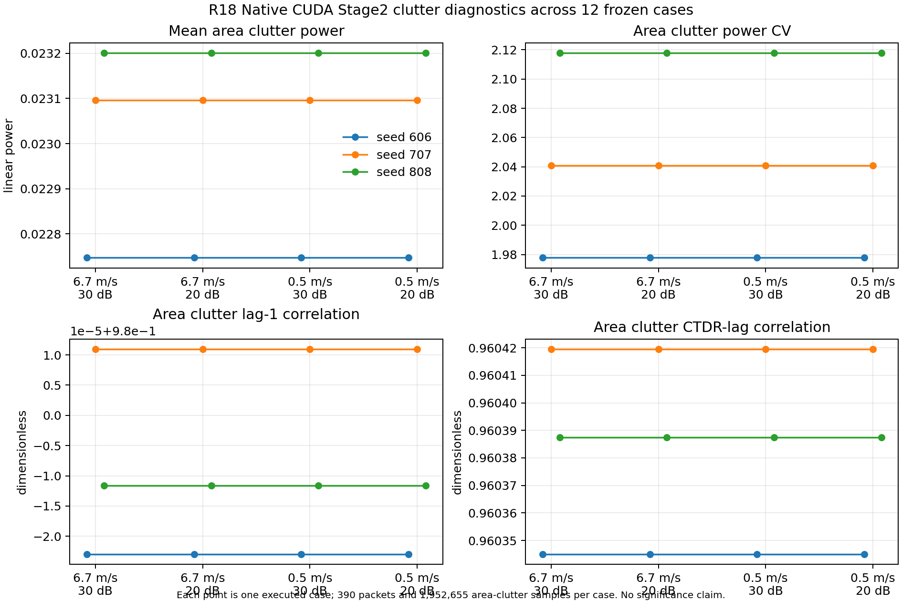

# R18：信号与 GMTI 任务结果

本报告只汇总 R18 已执行的 12 个 Native CUDA 场景，不把同一场景内的 periods 当成独立 seed，也不将候选数量或 CFAR hit fraction 写成 Pfa。

## 连续面积杂波确实注入

Stage2 使用 84,500–85,500 m 斜距窗；平台高度 6,000 m 时，该窗对应约 84,286.7–85,289.2 m 地距，物理可达。12/12 场景的 A0_ON 报告均记录 390 continuous-area packets、1,952,655 samples。测得杂波均功率范围为 0.0227470–0.0232009，均值为 0.0230146；功率 CV 为 1.9778–2.1179；lag-1 correlation 为 0.979977–0.980011；CTDR-lag correlation 为 0.960345–0.960419；热噪声均功率为 0.000999777–0.001000214。

这些值确认有效注入且 12 个场景的 Stage2 输入统计接近。每场景的原始记录见 [case gate CSV](evidence/formal_matrix/summary/r18_cuda_case_gate_summary.csv)。

图中点为单个已执行 case，不构成统计显著性检验。

## 处理闭合与 CFAR

- ideal 与 none 两类 ON−OFF−TO 因果 triplet 均在 12/12 场景通过，最大误差低于 5e-5 冻结容差。
- CFAR 每 period 的 full-band valid CUT 为 527,280；3 periods 的并集分母为 1,581,840。几何诊断、分母和 final-union hit 审计门均通过。
- 每 case 的 21 个 Production branch 均调用同一 Production binary；CSI taps 和运行日志随 snapshot 保留。
- C2/C3 的 Gamma complex estimate、有效 support、状态与参考来源保存在逐 case gamma_recovery.csv。当前可审计其运行值和输入条件；本阶段没有闭合 ON 目标污染对 Gamma 的因果影响，也没有把跨 seed support 波动转成任务收益结论。
- 各分支的 hit fraction 是通过阈值的 CUT 比例，仍包含目标和非目标 hit。缺少独立 truth-filtered H0 false-CUT 分子/分母，因此实测 Pfa 全部 NOT_EVALUABLE。

## 目标检测、航迹和参数记录

描述性汇总在四个速度/SNR 组合下，分别汇总 seed 606/707/808 的三个 period。C0、C1、C2 Mode-A/Mode-B、C3 Mode-A/Mode-B 与 A0 参考的每组可见目标周期均观察到 9/9 个目标匹配检测记录。该数值只是冻结场景的 truth-period hit 计数，不是统计 Pd，也没有在本阶段区分方法的检出率收益。

所有 ON 条件的 TrackManager truth-visible track PD 指标为 2/3；角度 RMSE 范围约 0.00981–0.04541°，地速 RMSE 约 0.496–16.971 m/s，位置 RMSE 约 15.61–89.34 m。它们是生产跟踪输出上的描述性指标；period 数少，且 ID-switch lineage 不能完整归因，不据此为方法排序。径向速度 RMSE 未闭合。

原始检测记录数及 truth-matched 与未匹配行数按条件差异很大，但未匹配 Detection 行不是 CFAR false CUT，也没有独立 H0 分母；不得据此声称虚警降低。C2/C3 Mode-A 使用配对 OFF 标定，信息条件优于在线条件；Mode-A 与 Mode-B 不能合并成同一部署能力排名。

按生产记录，本阶段没有完成 target-only 幅度/相位保持或可解释 SCNR 的闭合计算。CSI tap 的背景/噪声混合功率不能代替目标专属复增益。逐条件数值见 [ON 条件 CSV](evidence/formal_matrix/summary/r18_cuda_on_method_descriptive_summary.csv)，逐分支文件见各场景快照。

## 结果适用边界

本矩阵所有通道误差均为 0 ns。它提供零误差下传统 CSI 条件的 Production 任务观察，不测试未知误差造成的损失，不测试 Known physical correction 或盲校正能恢复多少，也不支持训练 AI 的必要性。全阶段 PERFORMANCE_VERIFIED=false。
