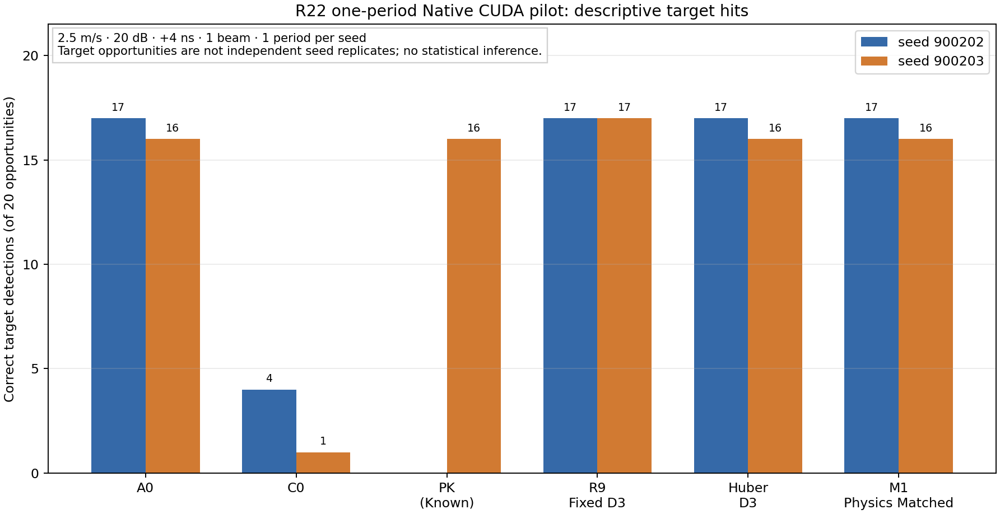

# R22-02：工程 screening pilot 执行结果

## 执行边界

R22 没有执行预注册 screening matrix。本报告记录进入全矩阵前的 20-target 工程验证与最小方法 pilot。实际执行均为本机 Native CUDA Production，`USE_COREX=OFF`；没有 CPU 模拟替代 GPU 证据，也没有训练 AI。

| seed | 速度 | SNR | 时延 | targets | beam | periods | 实际范围 |
|---:|---:|---:|---:|---:|---:|---:|---|
| 900101 | 0.5 m/s | 20 dB | 0 ns | 20 | 20 | 1 | 生成与 Production smoke；不作方法比较 |
| 900202 | 2.5 m/s | 20 dB | +4 ns | 20 | 1 | 1 | A0/C0/C2/C3 与 R9/Huber/M1 |
| 900203 | 2.5 m/s | 20 dB | +4 ns | 20 | 1 | 1 | 增加 PK/PKR 和 blind deterministic methods；PKR gate 失败 |

## 真实 CUDA 与物理场景

seed900203 Stage2 使用 6 km 高度平台，地面杂波斜距 84.5–85.5 km；几何可达 ground-range 84.287–85.289 km。A0_ON 报告实测连续面积杂波 130 packets / 650,892 samples，均值功率 0.0227563850584，噪声均值功率 0.00100075325241，面积功率 CV 2.04351886688，rho lag1 0.98005849427，CTDR lag2 相关 0.960526664864。

A1_OFF/ON/TO 报告的 `continuous_area_packets=0` 是复用造成的直接注入计数为零，不表示处理输入无杂波。`scenes_manifest.json` 写明 A0_ON 生成零误差 C+N 背景、所有 A0/A1 OFF/TO 与 A1_ON 复用该背景；A1_ON 的场景 `background_input_dir` 指向 A0_background，背景映射均为 `matched`。Ideal、Known、None 三组 causal triplet 的最大误差分别为 `9.06e-6`、`9.54e-6`、`9.06e-6`，均低于 `5e-5`。详见 [面积/配对审计](evidence/results/area_pairing_audit.json)。

## 描述性检测观察

下图展示已执行 pilot 的一周期命中计数；seed 内 target opportunities 不是独立统计重复。生成脚本为 [`plot_r22_descriptive_hits.py`](../../../../scripts/phase_r/plot_r22_descriptive_hits.py)。

| 方法 | seed900202 命中/机会 | seed900203 命中/机会 | 限制 |
|---|---:|---:|---|
| A0 | 17/20 | 16/20 | 每 seed 单周期、单 beam |
| C0 Current +4 ns | 4/20 | 1/20 | 同上；仅为两个工程 seed 的观察 |
| PK Known correction | 未运行 | 16/20 | Known 只在 seed900203 有结果 |
| R9 fixed D3 | 17/20 | 17/20 | seed 内盲估计候选；不能视为确认 |
| Huber D3 | 17/20 | 16/20 | seed900203 估计约 3.631 ns |
| M1 Physics Matched | 17/20 | 16/20 | seed900203 估计约 3.842 ns |
| C2 / C3 Mode-A 与 Mode-B | 各 4/20 | 各 1/20 | 两类信息条件分开报告；Mode-A 使用配对 OFF |
| PKR | 未运行 | NOT_EVALUABLE | 校准参考 support gate 失败 |

seed900203 的 ON 参数 RMSE（条件于成功匹配检测；单位按指标名）包括：A0 angle 0.01233° / position 18.39 m（16 次），C0 0.04334° / 64.29 m（1 次），PK 0.01233° / 18.39 m（16 次），M1 0.01705° / 25.35 m（16 次）。radial velocity 与 ground speed 均无有效机会。该条件化 RMSE 不表示未命中目标的参数误差。

## 阶段停止根因

`configs/research/production_hierarchical_calibration_delay_pilot.json` 当前配置 `min_support=8`、`range_band_bins=6`。PKR 参考输出的两个执行分支各有 26,637 groups：26,598 个 group 的 support 为 6，另 39 个 support 为 3；26,637/26,637 都是 `NOT_EVALUABLE / insufficient_phase_support`。adapter 显示 `valid_groups=0`、`all_groups_not_evaluable`。Production 运行后 scan beam quality gate 为 `valid=0/1 required=1 min_ratio=0.95`，退出码 1，无 CSI tap。

因此 PKR 的 Mode-A/B ON/OFF/TO 六个任务记录均不可评估，A0/PK/PKR residual closure 标记 `NOT_EVALUABLE`，原因 `csi_metric_tap_summary_missing:PKR`。不得降低 min-support 或 scan beam quality gate。失败归档保存了 runtime XML、完整失败日志、reference gamma CSV、adapter CSV、分支 manifest、CSI/CFAR 缺失状态和任务评估 CSV。

## 可评估性判定

- **可评价：** 本次 Stage2 杂波注入/共享身份、causal triplet、已成功 Production 分支的输出、逐目标单周期 hit/miss、条件于成功匹配检测的部分参数 RMSE、CFAR valid CUT 几何与分母。
- **仅描述：** 目标场景中检测行/未匹配 detection 数、20 个目标的一周期命中比例、两 seed 差异。
- **不可评价：** 独立 H0 统计 Pfa、确认航迹/跨周期连续性、radial velocity 和地速、PKR 估计/应用、A0/PK/PKR 完整 residual closure、总体 Pd/Pfa 改善、统计显著性。
- **阶段标签：** `IMPLEMENTED=true`、`EXECUTED=true`、`EVALUABLE=部分指标`、`PERFORMANCE_VERIFIED=false`。

详见 [执行质量审计](07_execution_and_quality_audit.md) 和 [紧凑失败证据包](evidence/preflight/seed900203_closure/README.md)。
