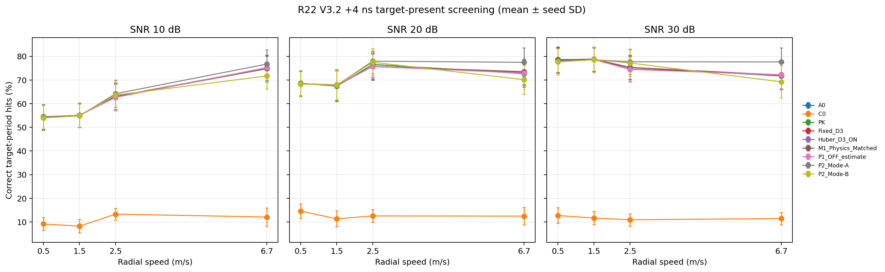
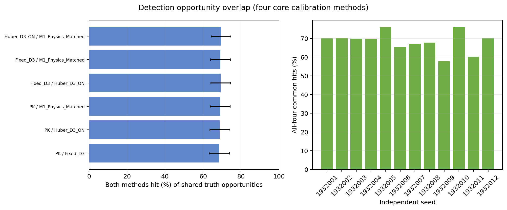

# 03｜目标检测、配对恢复与机会重叠

## seed 级检测

每个 seed 聚合 12 个 `+4 ns` 速度×SNR case，分母为 2,400 个有效目标周期机会。下表数值为 12 个独立 seed 的每 seed 命中率均值 ± seed 间样本标准差；只作 screening 描述，不作显著性结论。

| 方法 | 正确目标命中率 | 12 个 seed 覆盖 | 信息条件 |
|---|---:|---:|---|
| A0 no-error | 69.729% ± 5.139% | 12/12 | 参考 |
| C0 Current +4 ns | 11.694% ± 2.264% | 12/12 | 未校正 |
| PK Known correction | 69.729% ± 5.139% | 12/12 | evaluator-only 真值校正 |
| Fixed D3 | 69.705% ± 5.160% | 12/12 | 静态历史校正 |
| Huber D3 ON | 69.767% ± 5.146% | 12/12 | target-present raw C1/C2 |
| M1 Physics Matched | 69.767% ± 5.108% | 12/12 | target-present raw C1/C2 |
| P1 OFF estimate | 69.587% ± 5.169% | 12/12 | paired target-free OFF |
| P2 Mode-A | 71.108% ± 5.355% | 12/12 | paired OFF；对应 C4-A/PKR-A |
| P2 Mode-B | 68.750% ± 5.447% | 方法缺口限制 | paired OFF；完整 12-case triplet 仅 1/12 seed |

未知 +4 ns 下 `PK − C0` 的 seed 等权可恢复空间平均为 **58.035 个百分点**。Fixed D3、Huber、M1 的平均实际恢复分别为 58.010、58.073、58.073 个百分点，平均 recovery ratio 分别为 **99.970%、100.071%、100.074%**。Huber/M1 略高于 100% 是有限 screening 样本中的描述性比值，不代表超过物理上界；各 seed 的 PK−估计差异方向有正有负，不能据此宣称优于 Known。

A0 和 PK 汇总命中总数都为 20,082/28,800（69.729%）。每 case 命中数在 144 个 case 中有 142 个一致；另 2 个 case 的细小差异互相抵消。该证据支持任务级近似闭合，不是每个 opportunity 的逐位相同。参数 own-success 汇总也接近，详见[参数分析](04_common_success_parameter_analysis.md)。

全十周期位置机会的补充复算使用冻结 evaluator 保存的逐目标 `position_error_m`，不依赖仅保留 period 8 的 Detection CSV；四方法共同位置成功为 19,682/28,800（68.340%）。这扩展了位置参数的可评价范围，不改变上面的检测分母或检测筛选裁决。

## 十周期 Production 输出与真值未关联检测行

补充审计直接读取每个方法分支的 `cycle_metrics.csv` 与 `cluster_detection_lineage.csv`：144/144 case 的每个方法均有 10 个周期记录，合计 1,872 个方法×case 输出单元、18,720 个方法×case×周期记录。逐周期 `cycle_metrics.detection_count` 与 `selected_candidate_count` 完全一致；lineage 中簇行、selected/raw 标记也与各 beam summary 计数一致。13 种方法在全部 144 case 中的最终 Detection 行总数与 postfilter cluster 总数相同（逐 case 核对无差异）。

下表的“真值关联”只在冻结 evaluator 的 ON target-association 完整可评价时统计。31 个方法×case 单元因原 task status 不可评价，仍保留 Production 输出数量，但不计算目标漏检或未关联 Detection 数；它们分别是 P2 Mode-B 7 个、C4 Mode-B 15 个、PKR Mode-B 9 个。

| 方法 | 144 case 最终 Detection 行（= postfilter clusters） | 真值关联可评价 case | 目标机会 | 命中 / 漏检 | 真值未关联最终 Detection 行 |
|---|---:|---:|---:|---:|---:|
| A0 | 116,046 | 144/144 | 28,800 | 20,082 / 8,718 | 95,964 |
| C0 | 107,449 | 144/144 | 28,800 | 3,368 / 25,432 | 104,081 |
| PK | 116,048 | 144/144 | 28,800 | 20,082 / 8,718 | 95,966 |
| Fixed D3 | 117,330 | 144/144 | 28,800 | 20,075 / 8,725 | 97,255 |
| Huber D3 ON | 116,881 | 144/144 | 28,800 | 20,093 / 8,707 | 96,788 |
| M1 Physics Matched | 116,510 | 144/144 | 28,800 | 20,093 / 8,707 | 96,417 |
| P1 OFF estimate | 117,548 | 144/144 | 28,800 | 20,041 / 8,759 | 97,507 |
| P2 Mode-A | 111,579 | 144/144 | 28,800 | 20,479 / 8,321 | 91,100 |
| P2 Mode-B | 111,706 | 137/144 | 27,400 | 18,859 / 8,541 | 85,294 |
| C4 Mode-A | 101,621 | 144/144 | 28,800 | 3,231 / 25,569 | 98,390 |
| C4 Mode-B | 101,820 | 129/144 | 25,800 | 2,838 / 22,962 | 84,685 |
| PKR Mode-A | 110,507 | 144/144 | 28,800 | 20,537 / 8,263 | 89,970 |
| PKR Mode-B | 110,724 | 135/144 | 27,000 | 18,612 / 8,388 | 81,355 |

“真值未关联最终 Detection 行”按冻结 evaluator 的定义重算：最终 Detection 行数减去唯一关联到某个真值机会的 `det_id` 数。它表示未通过本次一对一真值关联门的检测行，可能包含未关联杂波候选、目标重复候选或未达到关联门的目标检测；**不是非目标簇计数，不是 false CUT/false cluster，也不是系统 Pfa**。compact ZIP 没有完整十周期的 cluster-to-truth lineage，因此非目标簇数为 `NOT_EVALUABLE`。各方法关联覆盖率不同，不能用表中未关联行数直接排算法名次。

逐 case、逐周期及 seed 汇总见 [`production_output_by_case.csv`](evidence/production_output_by_case.csv)、[`production_output_by_period.csv.gz`](evidence/production_output_by_period.csv.gz)、[`production_output_by_seed.csv`](evidence/production_output_by_seed.csv) 与 [`production_output_screening_summary.csv`](evidence/production_output_screening_summary.csv)。

## 同机会重叠

四个核心方法的预定真值机会和有效分母在 144/144 case 中对齐；所有核心方法完整记录 28,800 个机会/方法。全四方法共同命中率为 **68.340% ± 5.371%（seed 间 SD）**。

下表在相同机会集合上列出 PK 与估计方法的命中集合重叠，合计 28,800 个机会。`PK-only` 与 `estimated-only` 的差别很小，说明命中率接近的同时仍有少量具体目标周期发生互换。

| 配对 | 两者都命中 | 仅 PK 命中 | 仅估计方法命中 | 两者都未命中 |
|---|---:|---:|---:|---:|
| PK / Fixed D3 | 19,740 | 342 | 335 | 8,383 |
| PK / Huber D3 ON | 19,810 | 272 | 283 | 8,435 |
| PK / M1 | 19,868 | 214 | 225 | 8,493 |

这些总计是 opportunity 级描述，不把 28,800 个机会当成独立重复。按 seed 配对的 `PK − estimated` 平均差分别为 Fixed `−0.024 pp`、Huber `−0.038 pp`、M1 `−0.038 pp`；对应 seed 差的正负号并不一致，不能形成跨 seed 胜负主张。

## 不能从这些数据推出什么

- 这不是统计显著 Pd 改善，也不是外场/实机性能结论。
- `observed_cut_hit_fraction`、paired OFF false CUT 和配置理论 Pfa 不是系统 Pfa。
- P2 Mode-A 使用 paired OFF，不能当作 target-present 在线估计性能；P2 Mode-B 覆盖不够，不可排位。
- 检测已恢复接近 Known，并不意味着方位、位置、速度估计也闭合；参数另行评价。
