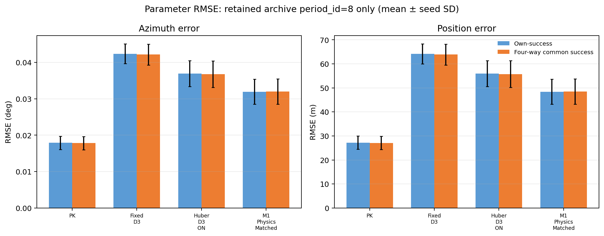

# 04｜共同成功机会参数误差

## 可复算的 period 8 子集

V3.2 compact ZIP 中核心 Production branch 只保留 `detection_results_GMTI09.csv`，对应 `period_id=8`。本轮以官方 `sample_key`、period、beam 和 det_id lineage 连接真值与检测，调用 V3.2 `r19_task_evaluator._parameter_errors` 重算角度、位置、斜距和折叠 Doppler 参数误差。匹配仅按 ID/period/beam 进行，不按行序配对。

本表只统计四个核心方法均有有效参数估计的同一组机会。共 **1,982 / 2,880 = 68.82%** 的 period-8 预定机会进入共同成功集；对每个 seed 先按其 12 个 case 合并，再计算 seed 间均值和样本 SD。

| 指标 | PK Known | Fixed D3 | Huber D3 ON | M1 Physics Matched |
|---|---:|---:|---:|---:|
| 方位 RMSE（deg） | 0.01782 ± 0.00184 | 0.04214 ± 0.00288 | 0.03678 ± 0.00366 | 0.03197 ± 0.00346 |
| 位置 RMSE（m） | 27.08 ± 2.78 | 63.87 ± 4.37 | 55.75 ± 5.55 | 48.48 ± 5.23 |
| 斜距 RMSE（m） | 0.7162 ± 0.0526 | 0.7197 ± 0.0578 | 0.7234 ± 0.0540 | 0.7224 ± 0.0536 |
| 折叠 Doppler RMSE（Hz） | 3.173 ± 0.504 | 3.226 ± 0.555 | 3.269 ± 0.543 | 3.267 ± 0.564 |

在这一个共同成功子集上，Huber 和 M1 相对固定 D3 的方位/位置误差更低：M1 相对 Fixed D3 平均降低约 `0.01017°` 和 `15.39 m`，12/12 个 seed 的差值方向一致；Huber 分别降低约 `0.00537°` 和 `8.12 m`，也是 12/12 seed 同向。二者仍未达到 PK；斜距与折叠 Doppler 没有表现出相同的改进方向。筛选样本上的方向一致性不等于预注册显著性或独立确认。

## 各方法 own-success 与四方法共同集的区别

各方法 own-success 只在本方法得到有效参数的 opportunity 上计算。V3.3 也输出这些值以展示选择集合，但主比较采用上表四方法共同成功集。两者都只覆盖 period 8。本轮没有把缺失估计填成零，也没有把漏检记成参数误差零值。

V3.2 原有 `parameter_metrics.csv` 还保存了十周期 own-success 聚合。V3.3 的检测产品不完整，不能用这些摘要重新建立共同成功集。原归档 summary 中的 full-period own-success 等权 seed 均值如下，**这是既有保存指标，V3.3 未独立复算**：

| 指标 | PK Known | Fixed D3 | Huber D3 ON | M1 |
|---|---:|---:|---:|---:|
| 方位 RMSE（deg） | 0.02118 | 0.04275 | 0.03775 | 0.03341 |
| 位置 RMSE（m） | 31.765 | 64.128 | 56.637 | 50.125 |
| 地速 RMSE（m/s） | 12.196 | 14.786 | 14.288 | 13.544 |
| 折叠 Doppler RMSE（Hz） | 3.279 | 3.278 | 3.283 | 3.278 |

这些 full-period own-success 值使用的方法成功机会不同，不能替代共同机会对照。V3.3 不能从 ZIP 中恢复全十周期参数机会的 Detection lineage；完整十周期共同成功方位/位置/速度 RMSE 均应标为 `NOT_EVALUABLE`。

## A0 与 PK 的近闭合

读取归档已有的全周期 own-success 参数计数/RMSE字段后，A0 与 PK 的方位、位置、斜距、折叠 Doppler累计有效参数数分别一致（每项 20,082）；144 个 case 中各有 2 个 case 的 own-success count 不同，但累计计数一致。按归档 own-success 数作加权合并的 RMSE为：

| 指标 | A0 no-error | PK Known |
|---|---:|---:|
| 方位（deg） | 0.021190 | 0.021191 |
| 位置（m） | 31.775 | 31.777 |
| 斜距（m） | 0.72709 | 0.72704 |
| 折叠 Doppler（Hz） | 3.28126 | 3.28137 |

这是从 ZIP 保留的 `parameter_metrics.csv` 自身成功摘要合并的近闭合检查，不是逐目标重算；地速 own-success 累计数也略有差异。检测总命中 A0/PK同为 20,082，但 2/144 case 的命中数有小差异。结论应表述为**本仿真与当前 V3.2 evaluator 下接近物理闭合**，不能称为完全逐机会相同。

## 未闭合参数

- **地速共同成功：** `NOT_EVALUABLE_TRACK_DEBUG_NOT_ARCHIVED`。full-period own-success 汇总存在，但逐机会航迹状态/payload 未留在 compact ZIP。
- **径向速度：** `NOT_EVALUABLE_NO_RESOLVED_VALID_SAMPLES_EXPECTED`。
- **完整十周期共同成功：** `NOT_EVALUABLE_ARCHIVE_RETAINS_INCOMPLETE_PERIOD_PRODUCTS`。
- **target-only 复数幅相：** `NOT_EVALUABLE`；当前保留 CSI ROI summaries 不能替代目标专属复数响应。
