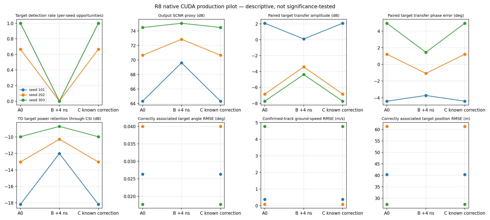

# R8 三 seed 目标检出因果结果

日期：2026-10-23。实验设计见 [R8 冻结设计](R8_experiment_design.md)，CUDA 执行与完整身份见 [R8 执行记录](R8_native_cuda_execution.md)。

## 目标检出

每个 period 有一个可见目标机会；仅当 Production detection 按 R7 冻结规则匹配同 period、同 beam、range ±2 bins、circular Doppler ±2 bins 时才记为正确检出。每个 seed 三个 period 不视为统计独立样本。

| Seed | A0：0 ns | B：Current +4 ns | C：Known Correction |
|---:|---:|---:|---:|
| 101（复用 R7） | 3/3 | 0/3 | 3/3 |
| 202 | 2/3 | 0/3 | 2/3 |
| 303 | 3/3 | 0/3 | 3/3 |
| 合计（描述性） | **8/9** | **0/9** | **8/9** |

对这组仿真目标和固定 `+4 ns` 注入，未知误差条件 B 在三个 seed 均未产生门内正确目标 detection；Known Correction C 将观察到的 8 个 A0−B 检出机会缺口全部恢复到 A0 的计数。此结果是可行性与因果方向证据，不是统计显著的 Pd 改善。

| Seed | 条件 | 正确目标 detection / 机会 | 漏检 | ON 非目标/未匹配 detections | 正确 confirmed-track 关联 | 未关联的 confirmed tracks |
|---:|---|---:|---:|---:|---:|---:|
| 101 | A0 | 3/3 | 0 | 172 | 2 | 27 |
| 101 | B | 0/3 | 3 | 161 | 0 | 42 |
| 101 | C | 3/3 | 0 | 172 | 2 | 27 |
| 202 | A0 | 2/3 | 1 | 181 | 1 | 30 |
| 202 | B | 0/3 | 3 | 189 | 0 | 52 |
| 202 | C | 2/3 | 1 | 181 | 1 | 30 |
| 303 | A0 | 3/3 | 0 | 244 | 2 | 71 |
| 303 | B | 0/3 | 3 | 226 | 0 | 84 |
| 303 | C | 3/3 | 0 | 244 | 2 | 70 |

“非目标/未匹配 detection”是 Production 最终 detection 中未与可见真值按冻结一对一门匹配的记录数；“未关联 confirmed tracks”是当周期确认且有匹配 detection、但未关联到正确目标 detection 的航迹数。两者都是场景计数，不是 Pfa。OFF/H0 的 false cluster/detection 与 false confirmed track 另见下表。

## CSI 与目标保持指标

| Seed | 指标 | A0 | B +4 ns | C Known |
|---:|---|---:|---:|---:|
| 101 | H0 CSI cancellation (dB) | 5.591 | 5.132 | 5.590 |
|  | Output SCNR proxy (dB) | 64.331 | 69.614 | 64.331 |
|  | 配对目标复传递幅度 (dB) | 2.081 | 0.102 | 2.081 |
|  | 配对目标复传递相位误差 (deg) | -4.416 | -3.734 | -4.416 |
|  | TO 目标功率经 CSI 保持 (dB) | -18.176 | -12.010 | -18.176 |
| 202 | H0 CSI cancellation (dB) | 5.818 | 5.329 | 5.818 |
|  | Output SCNR proxy (dB) | 70.652 | 72.845 | 70.651 |
|  | 配对目标复传递幅度 (dB) | -6.845 | -3.424 | -6.846 |
|  | 配对目标复传递相位误差 (deg) | 1.228 | -1.078 | 1.229 |
|  | TO 目标功率经 CSI 保持 (dB) | -13.037 | -10.274 | -13.037 |
| 303 | H0 CSI cancellation (dB) | 5.436 | 4.994 | 5.437 |
|  | Output SCNR proxy (dB) | 74.462 | 75.050 | 74.467 |
|  | 配对目标复传递幅度 (dB) | -7.737 | -4.384 | -7.739 |
|  | 配对目标复传递相位误差 (deg) | 4.954 | 1.458 | 4.955 |
|  | TO 目标功率经 CSI 保持 (dB) | -9.972 | -8.717 | -9.972 |

SCNR proxy 定义为 truth-centered TO 目标 ROI 功率除以配对 OFF 的同 ROI H0 功率。TO 目标功率保持量为 CSI 输出功率相对 CSI 前等化目标功率的 dB 比值。配对目标复传递量由 CSI(TO) ROI 与 CSI(ON)−CSI(OFF) 得出，属于诊断量，不等价于独立物理目标增益。它们不应单独替代 detection/track 任务结果。

## 参数估计与 H0 描述计数

只有正确关联的目标参与参数 RMSE；B 无门内目标 detection，因此参数 RMSE 为 `NOT_EVALUABLE`。

| Seed | 条件 | 方位 RMSE (deg) | 地速 RMSE (m/s) | 位置 RMSE (m) | 径向速度 |
|---:|---|---:|---:|---:|---|
| 101 | A0 / C | 0.0263 / 0.0263 | 0.3826 / 0.3826 | 40.34 / 40.34 | 未解模糊，NOT_EVALUABLE |
| 202 | A0 / C | 0.0400 / 0.0400 | 0.0852 / 0.0852 | 61.40 / 61.40 | NOT_EVALUABLE |
| 303 | A0 / C | 0.0177 / 0.0177 | 4.7778 / 4.7778 | 27.33 / 27.33 | NOT_EVALUABLE |

| Seed | H0 false clusters/detections：A0 / B / C | False confirmed tracks：A0 / B / C |
|---:|---|---|
| 101 | 24 / 27 / 24 | 4 / 4 / 4 |
| 202 | 28 / 31 / 28 | 4 / 4 / 4 |
| 303 | 26 / 28 / 26 | 5 / 4 / 5 |

这些 H0 计数是本次场景中的描述性候选数，不是统计 Pfa。

新增 seed 的三期 H0 unique union hit cells（每条件 1,581,840 valid CUT）为：seed202 A/B/C=`432/472/432`；seed303=`396/428/396`。seed101 的 R7 exact union maps 未保存，因此该项为 `NOT_EVALUABLE`。H1 union hits 和逐期任务证据见 [条件 CSV](evidence/r8_unknown_delay_multiseed_20261023/evaluation/r8_seed_condition_metrics.csv)、[任务与 lineage 目录](evidence/r8_unknown_delay_multiseed_20261023/evaluation/)。

| Seed | 条件 | ON 两分支 hit cells 合计 | ON unique union hits | OFF 两分支 hit cells 合计 | OFF unique union hits | 每角色 valid CUT（3 periods） |
|---:|---|---:|---:|---:|---:|---:|
| 202 | A0 | 2,501 | 1,509 | 705 | 432 | 1,581,840 |
| 202 | B | 3,790 | 2,461 | 708 | 472 | 1,581,840 |
| 202 | C | 2,500 | 1,508 | 705 | 432 | 1,581,840 |
| 303 | A0 | 3,330 | 1,874 | 653 | 396 | 1,581,840 |
| 303 | B | 5,018 | 3,125 | 660 | 428 | 1,581,840 |
| 303 | C | 3,331 | 1,874 | 653 | 396 | 1,581,840 |

两分支 hit-cell 合计会重复计入两个 branch 同时命中的 CUT；union 列才是去重计数。CUT 命中数与 configured `Pfa=1e-6` 不是统计 Pfa 估计。

## 限制

- seed101 来自 R7 修复后归档，seed202/303 对应的重建输入与历史 R3 manifest 均 27/27 SHA/byte 匹配；但 seed 数少、场景类型单一。
- OFF/H0 候选和 CFAR hit cells 不转写为统计 Pfa；本实验没有统计独立的虚警试验分母。
- `PERFORMANCE_VERIFIED=false`。结果不外推至真实机载误差分布、其他时延、低速扫描或多参数耦合情形。
